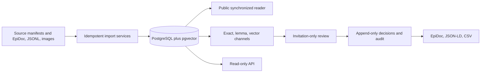

# Architecture

Sutura is a standalone Rails monolith. The public boundary is deliberately
language-neutral: EpiDoc XML, JSONL, JSON Schema, JSON-LD, CSV, and HTTP JSON.

## Invariants

- A source reading is never overwritten by normalization.
- Every reading points to a source artifact with a license and citation.
- Reading revisions, review decisions, and audit events are append-only.
- Candidate matches are proposals; only accepted matches become confirmed
  assertions in JSON-LD and CSV exports.
- Vector-only evidence remains visibly labelled and cannot accept itself.
- All externally supplied XML is parsed without network access.

## Runtime

Rails owns the web UI, import orchestration, provenance, review, exports, and
jobs. PostgreSQL provides exact/trigram search and vector storage. Informers
runs local ONNX embeddings from Solid Queue jobs. Python is not required.
